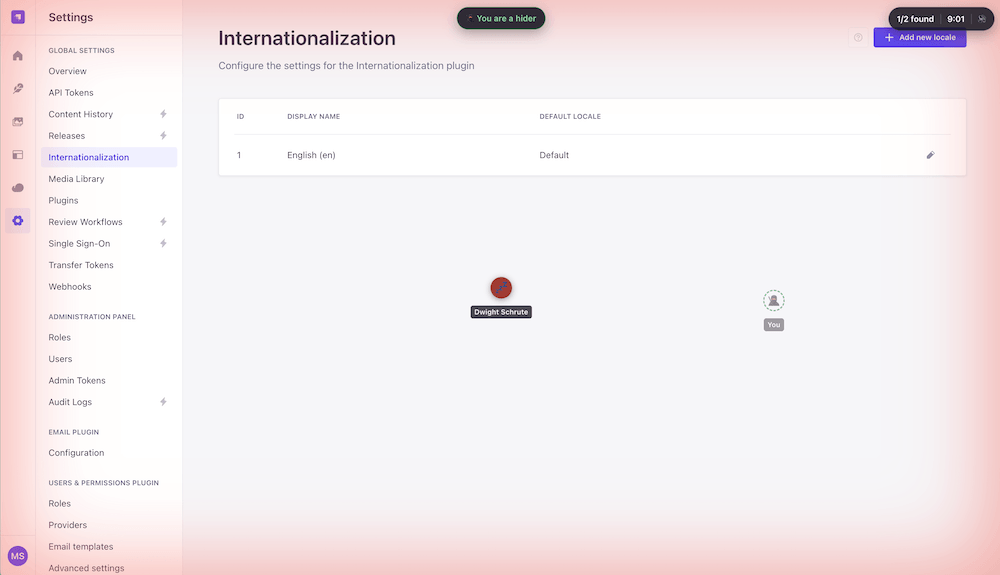
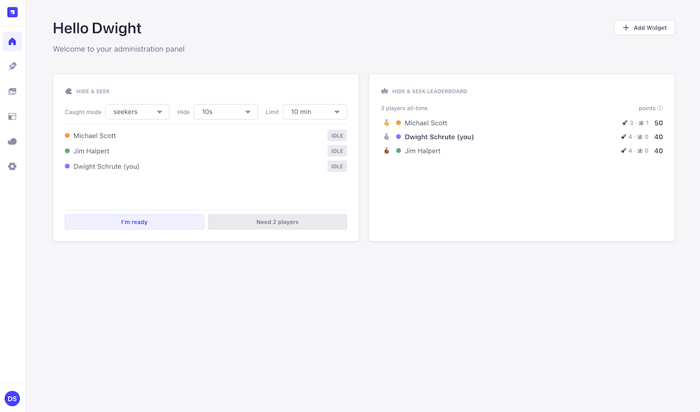
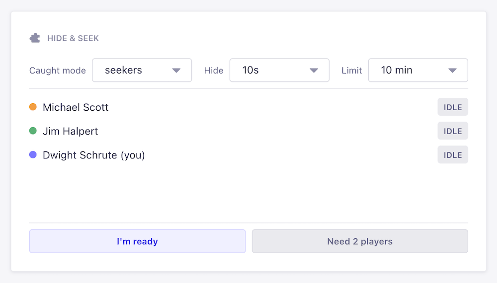
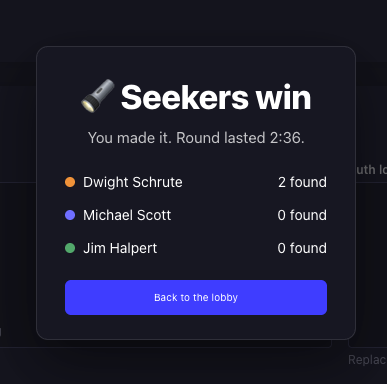
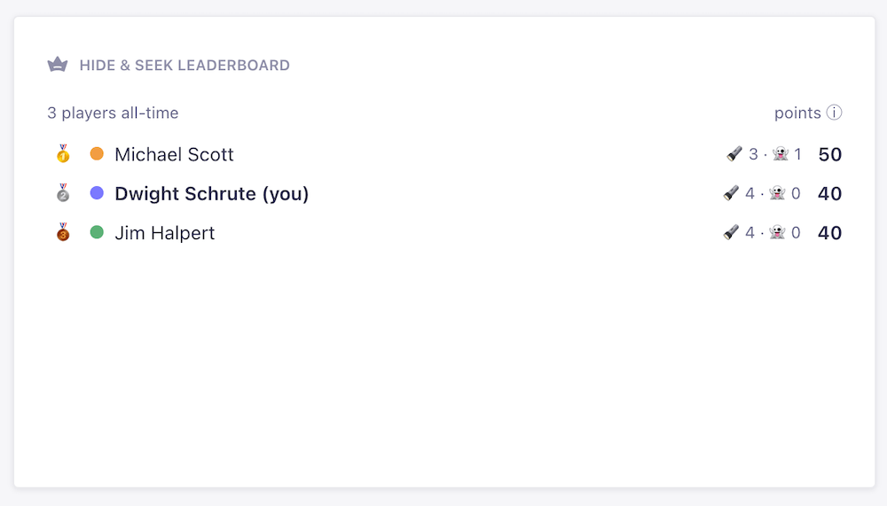

# Hide & Seek for Strapi

[](https://www.npmjs.com/package/strapi-plugin-hide-and-seek)
[](https://www.npmjs.com/package/strapi-plugin-hide-and-seek)
[](https://strapi.io)
[](./LICENSE)

Hide and seek, played inside the Strapi admin panel.

Every admin user is a player, every admin route is a hiding spot, and the mouse
cursor is the character. No canvas, no game engine — the game is the CMS you
already spend your day in.

> Built for the end of a sprint, a new joiner's first afternoon, or any excuse to
> make five people click around the same Strapi at the same time.

<p align="center">
  
</p>

<p align="center"><em>A hider cornered in Settings. The pill says what you are, the
screen reddens because a seeker is in the room, and the dashed marker labelled
<strong>You</strong> is the hider's own position — trailing their cursor, because a
cornered hider is slowed. The seeker's red marker shows 💤: they have tabbed away,
so the game parked them in the middle of the page.</em></p>

## Requirements

- **Strapi 5.13 or later** — the lobby is a homepage widget, and that API
  (`app.widgets.register`) landed in 5.13.0.
- **A single Strapi instance.** Game state lives in memory, so behind a load
  balancer with several nodes players on different nodes cannot see each other.
- Node 18+.

## Install

```bash
npm install strapi-plugin-hide-and-seek
```

The plugin is auto-discovered — no config entry needed. Rebuild the admin and
start Strapi:

```bash
npm run build && npm run develop
```

Both widgets then appear on the admin homepage on their own.



**Unless you have already rearranged your homepage.** Strapi saves a widget
layout per admin user, and a saved layout lists the widgets it shows by name — so
widgets registered later are not in it and stay hidden. If your homepage looks
unchanged after installing, use **Add Widget** on the homepage to place
_Hide & Seek_ and _Hide & Seek leaderboard_. Each player does this once, for
their own homepage. The plugin deliberately does not rewrite anybody's saved
layout.

Players are ordinary Strapi admin users. Create one per person under
**Settings → Administration panel → Users**, or from the CLI:

```bash
npx strapi admin:create-user -e player@example.com -p 'a-password' -f First -l Last
```

Everyone logs into the same Strapi. The lobby is waiting on the homepage.

## How a round works

**1. Lobby.** A widget on the admin homepage lists everyone currently connected.
A second widget keeps the all-time leaderboard.

<p align="center">
  
</p>
Players mark themselves ready and agree on the house rules. Two ready players are
enough to start.

**2. Countdown.** 3… 2… 1…, roles still secret — nobody knows who is about to be
the seeker, including the seeker.

**3. Hiding.** One player is revealed as the seeker and is blindfolded by a
full-screen overlay. Everyone else gets a few seconds to go anywhere in the
admin: Content Manager, Media Library, Settings, one specific entry. The route
they end on _is_ their hiding spot.

**4. Hunting.** The seeker browses the admin looking for company. The moment a
seeker and a hider share a page they see each other at once, and **both are
locked in**: links stop working for a few seconds, so the hider has to dodge
rather than click away. The hider is also **slowed** — their marker chases their
real cursor at a capped speed instead of being it, so flicking the mouse across
the screen buys distance over time rather than instantly. The seeker catches them
by holding their own cursor on the marker for a beat.

Everyone carries a pill at the top of every page saying what they are, so you
never have to remember whether you are hiding or hunting.

**5. Over.** The round ends when every hider has been found, or when the clock
runs out and the survivors win. Everybody's ready flag is cleared, so the next
round starts only when people opt into it again — and the lobby widget goes
straight back to being the lobby, ready to deal a new round while the last
result is still on screen. Closing the results card takes you back to the
homepage, and only you: it does not end anybody else's round.

### Where you are

A hiding spot is the admin route you are on — but some screens keep their
location in the query string rather than the path. The Media Library is the
obvious one: every folder is the same pathname with a different `folder`
parameter, so without help everybody in the Media Library would share one room
regardless of the folder they opened. `pageQueryKeys` lists the parameters that
count. Filters, sort and pagination are left out on purpose: two people looking
at the same list through different filters are still in the same place, and
treating those as separate rooms would make anyone unfindable.

**One tab per player.** Opening the admin in a second tab hands the game to the
newest tab and disconnects the older one, which is told why. With two tabs live
they would both report a page, the server would keep whichever spoke last, and
you would end up standing wherever your other tab happened to be — including on
pages you had already left or deleted.

### Manhunt

Set **Mode** to _manhunt_ in the lobby and pick who everybody is after. That
player is the only hider; every other player is a seeker. The round ends the
moment they are caught — or they win by lasting the whole clock, and the result
card leads with how long they survived.

Two rules change, because the classic ones make a manhunt unplayable:

- **The prey is never locked in.** Frozen in a room with a dozen hunters is an
  instant catch, so they can always run. The hunters are still locked by the
  encounter, which is what stops the swarm from simply taking turns. Set
  `preyEscapesLockdown: false` if you want it brutal.
- **There is no safe zone.** Otherwise the prey stands on the homepage and runs
  out the clock.

They are still slowed while a hunter shares their page, so they can flee a room
but not dance around it.

### The safe zone

The admin **homepage is neutral ground**: no lockdown, no slowdown, no catching.
It is where the lobby and the leaderboard live, so you can always get back to
them without being ambushed. Camping there is allowed but pointless — a hider
sitting on the homepage when the clock runs out does not count as having
survived, and scores nothing.

### Getting caught

Being caught takes over your screen and tells you how long you lasted. What
happens next depends on the `caughtBecome` setting: you either join the hunt as a
seeker, or you drop out as a spectator.

Spectators see everything — every player on whatever page they are on, rendered
as faded ghosts — and get a **follow** bar at the bottom of the screen to tail a
player with ‹ and ›. Following moves you to whatever page they are on, and keeps
up as they run. Players never see spectators.

### When the seeker is lost

A seeker who has not laid eyes on anybody for `hintAfterMs` gets a nudge: the
link leading towards somebody starts pulsing in the sidebar, and a pill names the
page if nothing on screen points there. The hint names a **page, never a person**,
and it refreshes every `hintRepeatMs` until they find someone.

<p align="center">
  
</p>

## Leaderboard

<p align="center">
  
</p>

The plugin adds two homepage widgets: the lobby and an all-time leaderboard.
Standings survive restarts — they are kept in Strapi's core store, not in memory,
and deliberately **not** as a content type: a game has no business adding a
collection to somebody's Content Manager.

Scoring is simple enough to argue about:

|                            |               |
| -------------------------- | ------------- |
| Player found, as a seeker  | **10 points** |
| Round survived, as a hider | **20 points** |

Each row also tracks rounds played, rounds seeking, players found, escapes and
times caught. Your own row is pinned to the bottom of the board if you are not in
the top ten.

Standings are stored under the core-store key `plugin_hide-and-seek_leaderboard`;
delete that row to wipe the board.

## Rules that keep it honest

- **No camping.** A hider whose cursor stops moving for a couple of seconds is
  revealed by a pulsing ping. Parking the mouse off-screen loses the round.
- **No hiding in another window.** Clicking away to another app parks your marker
  in the middle of your page, flagged as away. You are still in the game, and
  much easier to find.
- **No mouse-flicking.** A cornered hider's marker is speed-limited, so escaping
  a standoff takes dodging rather than one fast swipe.
- **No peeking.** The server never sends the seeker a hider they have not earned
  sight of, so there is nothing to read in the network tab.
- **No running from a standoff.** The lockdown is enforced on the server, not just
  in the UI. Clicks are swallowed in the capture phase before the admin's router
  sees them; a reload or the back button can still move the browser, but the game
  ignores the move and keeps the player in the room, still catchable. Escaping
  that way gains nothing.
- **No rage-quitting.** Leaving takes you out of the round entirely — you are
  removed from the roster rather than left standing there to be hunted. Closing
  the tab or logging out counts as leaving; logging out gives up the seat at
  once, while a dropped connection is held briefly first so that reloading the
  admin does not cost you the game.
- **No removing the players.** While a round is on, the admin API refuses to
  delete an admin user who is in it — single or batch — or to deactivate them,
  answering 409 and naming who is playing. The lobby is built out of admin users,
  so removing one mid-game strands everyone waiting on a player who no longer
  exists. Everything else still works: renaming a player, editing their roles,
  and deleting or deactivating anyone not in the round.
- **No hollow rounds.** If every seeker leaves, the round ends there and then and
  the hiders win — nobody is left to find them. The same goes the other way: if
  the last hider walks out, the seekers have found everyone there is to find.
- **No wandering off.** While a round is running, every link leaving the admin —
  the Marketplace entry, documentation links, anything off-origin — is dimmed and
  dead. One stray click into a new tab used to take a player out of the game.

## Configuration

Everything has a playable default. Override any of it in `config/plugins.ts`:

```ts
export default {
  'hide-and-seek': {
    enabled: true,
    config: {
      hideSeconds: 10,
      lockdownMs: 4000,
      caughtBecome: 'seeker',
    },
  },
};
```

| Option                | Default                    | What it does                                                                                                           |
| --------------------- | -------------------------- | ---------------------------------------------------------------------------------------------------------------------- |
| `countdownSeconds`    | `3`                        | "3… 2… 1…" before roles are revealed.                                                                                  |
| `hideSeconds`         | `10`                       | Time to scatter while the seeker is blindfolded.                                                                       |
| `roundSeconds`        | `600`                      | Hard time limit. Hiders still free at 0:00 win.                                                                        |
| `graceMs`             | `0`                        | How long a hider stays invisible after a seeker arrives. Off by default: the lockdown already gives them their chance. |
| `hiderSpeedLimit`     | `0.3`                      | Top speed of a cornered hider's marker, in viewport widths per second. `0` disables the slowdown.                      |
| `safeZone`            | `true`                     | Whether the admin homepage is neutral ground.                                                                          |
| `pageQueryKeys`       | `['folder', 'folderPath']` | Query parameters that count as part of _where you are_. Filters and sort deliberately do not.                          |
| `hintAfterMs`         | `45000`                    | How long a seeker goes without a sighting before being nudged.                                                         |
| `hintRepeatMs`        | `20000`                    | How often the nudge picks a fresh target.                                                                              |
| `lockdownMs`          | `15000`                    | How long a shared page locks both players in place.                                                                    |
| `catchRadius`         | `0.09`                     | Catch distance, as a fraction of the viewport.                                                                         |
| `catchHoldMs`         | `800`                      | How long the seeker must hold the cursor to catch.                                                                     |
| `idleRevealMs`        | `2000`                     | A motionless hider is revealed after this.                                                                             |
| `caughtBecome`        | `'seeker'`                 | `'seeker'` for tag-team, or `'spectator'`.                                                                             |
| `seekerCount`         | `1`                        | Seekers drawn at the start of a round.                                                                                 |
| `mode`                | `'classic'`                | `'classic'` deals seekers against the rest; `'manhunt'` puts one named player against the whole room.                  |
| `preyId`              | `null`                     | Manhunt only: who is hunted. Falls back to a random player.                                                            |
| `preyEscapesLockdown` | `true`                     | Manhunt only: whether the prey is exempt from the lockdown.                                                            |
| `forfeitAfterMs`      | `20000`                    | A disconnected hider forfeits after this.                                                                              |
| `tickHz`              | `20`                       | Server tick and position broadcast rate.                                                                               |
| `corsOrigin`          | `true`                     | socket.io CORS origin. `true` reflects the request origin.                                                             |

`caughtBecome`, `hideSeconds`, `roundSeconds` and `seekerCount` can also be
changed from the lobby widget between rounds, without a restart.

### Tuning the feel

Two numbers decide whether a standoff is winnable. `lockdownMs` is how long the
hider is stuck in the room, and `hiderSpeedLimit` is how far they can travel
while they are. At the defaults a cornered hider is frozen for 15 seconds and can only drift at
0.3 screens per second, against a catch radius of 0.09 — a standoff the seeker
should usually win. Earlier defaults (4s, 0.55, 0.06) made hiders very hard to
catch. Raise `hiderSpeedLimit` and lower `lockdownMs` for slippery hiders; the
three numbers are the whole difficulty dial.

## How it works

- **Transport.** A socket.io server attached to Strapi's own HTTP server
  (`strapi.server.httpServer`) at `/hide-and-seek/socket.io`. No second port, no
  extra process.
- **Auth.** The admin panel asks the authenticated route
  `GET /hide-and-seek/ticket` for a single-use, 30-second handshake ticket and
  hands it to the socket server. The socket layer never needs to know how Strapi
  stores admin sessions, which keeps it working across Strapi's auth changes.
- **Authority.** The server decides everything: who seeks, who is visible to whom,
  who is locked in, and whether a catch happened — computed from both cursors
  server-side. The client only draws what it is told.
- **State.** Round state is entirely in memory: a round is short and a restart just
  sends everyone back to the lobby, so nothing there is worth a database
  round-trip at 20Hz. Only the leaderboard is persisted, once per round, when it
  ends.
- **Admin UI.** The lobby is a homepage widget. The game overlay has no such slot —
  nothing in the admin renders on every route — so it mounts its own React root on
  `document.body` from the plugin's `bootstrap()`, which survives client-side
  navigation. Cursor positions are written straight to the DOM from an animation
  frame rather than through React state; 20Hz of coordinates should not re-render
  the panel.

## Long rounds and admin sessions

Strapi ends an idle admin session, and a hider who has found a good spot stops
clicking entirely — a socket carries no HTTP activity, so they used to be logged
out mid-round. While a round is running the plugin polls an authenticated
endpoint once a minute, which keeps the admin's token refreshed on its own
schedule.

For long sessions you can also widen the window in `config/admin.ts`:

```ts
auth: {
  sessions: {
    idleSessionLifespan: 60 * 60 * 1000, // and idleRefreshTokenLifespan,
    maxSessionLifespan: 8 * 60 * 60 * 1000, // maxRefreshTokenLifespan
  },
},
```

Logging out on purpose is still allowed, and now simply takes you out of the
round — see the leaving rules above.

## Known limitations

- Single Strapi instance only (see Requirements).
- Keyboard-driven navigation during a lockdown — typing a URL, `Cmd+L`, the back
  button — is not blocked in the UI. The server still refuses the move, so it is
  not an advantage, but the escapee's screen will show a page the game does not
  think they are on.
- Following a player as a spectator is a real page navigation, so it reloads the
  admin each time your target moves. There is a short settle delay to stop a
  restless player from thrashing your tab.
- Positions are viewport-relative, so players on very different screen sizes see
  ghosts in slightly different places relative to the page content.

## Local development

```bash
git clone https://github.com/Adzouz/StrapiPluginHideAndSeek.git
cd strapi-plugin-hide-and-seek
npm install
npm run build      # or: npm run watch
```

To try it in a Strapi project on the same machine:

```bash
cd ../my-strapi-project
npm install ../strapi-plugin-hide-and-seek
```

A symlinked plugin ships its own copy of React, which breaks hooks in the admin.
Add `src/admin/vite.config.ts` to the host project:

```ts
import { mergeConfig, type UserConfig } from 'vite';

export default (config: UserConfig) =>
  mergeConfig(config, {
    resolve: { dedupe: ['react', 'react-dom', 'styled-components', 'react-router-dom'] },
  });
```

`strapi develop` does not watch `node_modules`, so restart it after rebuilding
the plugin.

## Code style and commits

ESLint and Prettier run over the whole repo, with Husky wiring them into git:

```bash
npm run lint          # eslint
npm run lint:fix
npm run format        # prettier --write
npm run format:check
```

- **pre-commit** runs `lint-staged`: ESLint `--fix` then Prettier, on staged files only.
- **commit-msg** runs `commitlint` against
  [Conventional Commits](https://www.conventionalcommits.org). Scopes are checked
  against the ones this repo actually uses (`server`, `admin`, `overlay`,
  `widget`, `i18n`, `game`, `tests`, `docs`, `deps`, `ci`) — an unknown scope is a
  warning, not a failure.

```
feat(overlay): add the spectator follow bar
fix(game): stop a logged-out player lingering in the lobby
```

Hooks install themselves through the `prepare` script. It ends in `|| true` so
that installing this package somewhere without git does not fail.

## Tests

`tests/e2e.mjs` plays a full headless round against a running Strapi: it logs two
admin users in, takes tickets, connects both sockets and asserts that roles stay
secret during the countdown, that both sides see each other the moment they share
a page, that the lockdown blocks a page change and lifts on time, that a
sustained cursor lock produces a catch, that `caughtBecome` is honoured, that the
round lands on the leaderboard with the right points, and that a finished round
leaves the lobby usable with everyone back to idle.

`tests/mechanics.mjs` covers the duel rules: immediate visibility on arrival, the
speed limit on a cornered hider, the away-from-window parking, the safe zone, and
the survival time carried by a catch.

`tests/disconnect.mjs` covers who stays in the roster: a reload keeps your seat,
logging out gives it up at once, a player who never comes back is swept, and
leaving mid-round drops you from it — including the case where the last seeker
walks out and the round ends on the spot.

`tests/deletion.mjs` checks the guard that stops an admin user being deleted or
deactivated out of a running round — and that it gets out of the way in the lobby, for
non-players, and once the round is over. Every account it deletes is one it
created for the purpose, so it leaves your test users alone; still, point it at a
scratch project rather than anything you care about.

`tests/manhunt.mjs` covers the whole-room mode: role dealing, the two exemptions
that keep it playable, and the survival time on the result.

`tests/tabs.mjs` covers the two ways a player's position could drift from where
they actually are: a second tab taking over, and screens that keep their location
in the query string.

`tests/spectator.mjs` needs three players and covers what happens after a catch:
the follow roster, the one-way visibility between spectators and players, and the
hint a stuck seeker eventually gets. That last check waits out `hintAfterMs`; set
`HNS_SKIP_SLOW=1` to stop before it.

```bash
npx strapi admin:create-user -e seeker@hns.test -p 'HideSeek1!' -f Sam -l Seeker
npx strapi admin:create-user -e hider@hns.test  -p 'HideSeek1!' -f Hana -l Hider
npx strapi admin:create-user -e third@hns.test  -p 'HideSeek1!' -f Jim  -l Halpert

HNS_URL=http://127.0.0.1:1337 npm run test:e2e
HNS_URL=http://127.0.0.1:1337 npm run test:mechanics
HNS_URL=http://127.0.0.1:1337 npm run test:spectator
HNS_URL=http://127.0.0.1:1337 npm run test:disconnect
HNS_URL=http://127.0.0.1:1337 npm run test:deletion
HNS_URL=http://127.0.0.1:1337 npm run test:tabs
HNS_URL=http://127.0.0.1:1337 npm run test:manhunt
```

The suites can be run back to back: `tests/helpers.mjs` caches admin tokens in
`tests/.tokens.json` (gitignored) and reuses them across runs, so Strapi's login
rate limit is never reached. Delete that file to force fresh logins. Settings do
carry over between runs, since the lobby keeps them until someone changes them.

Override `HNS_URL`, `HNS_USER_A`, `HNS_USER_B` and `HNS_PASSWORD` to point it
elsewhere.

## Translations

The admin panel and the in-game overlay are fully translated into **15 languages**
besides English: French, German, Spanish, Italian, Portuguese (Portugal and
Brazil), Dutch, Polish, Russian, Ukrainian, Turkish, Japanese, Korean and Chinese
(Simplified and Traditional). The plugin follows whatever language the admin user
picked in their profile; any locale without a catalogue falls back to English, so
nothing ever renders blank.

Adding a language is one file:

```bash
cp admin/src/translations/en.json admin/src/translations/<locale>.json
```

Keep the keys exactly as they are — they are the full message ids, prefixed with
`hide-and-seek.`, because Strapi merges plugin catalogues without namespacing
them — and translate the values. `{name}`, `{count}` and friends are
placeholders and must survive the translation. Locale codes are the ones Strapi
itself ships (`fr`, `pt-BR`, `zh-Hans`, …).

The overlay renders outside Strapi's `IntlProvider`, so it cannot use react-intl;
it reads the same catalogues through a small helper in `admin/src/i18n.js`. Both
paths share one set of keys, and `admin/src/i18n.js` holds the English source of
truth.

Translations beyond English were written without native review — corrections are
very welcome.

## Releasing

Releases are published from GitHub Actions, not from a laptop. Pushing a `v*`
tag runs `.github/workflows/release.yml`, which refuses to publish if the tag and
`package.json` disagree, then publishes with
[npm provenance](https://docs.npmjs.com/generating-provenance-statements) — so
the npm page shows which commit and workflow run actually built the tarball.

```bash
npm version minor          # or patch / major; updates package.json
git push && git push --tags
```

One-time setup on the npm side, either:

- **Trusted publishing** (no secret to leak): on npmjs.com, under the package's
  settings, add a trusted publisher for this repository and
  `release.yml`. Then drop the `NODE_AUTH_TOKEN` line from the workflow.
- **Or an automation token**: create a granular access token with publish rights
  and 2FA bypass, and add it to the repository as the `NPM_TOKEN` secret. The
  workflow uses this by default.

Every push and pull request also runs `.github/workflows/ci.yml`: lint, format
check, build, and `strapi-plugin verify`. The game suites are not part of CI —
they need a live Strapi with real admin users, so they stay a local step.

## Contributing

Issues and pull requests welcome. Good first additions: a language (see above),
new catch mechanics, per-round scoreboards, and a way to make long hiding spots
leak a hint.

## License

MIT
